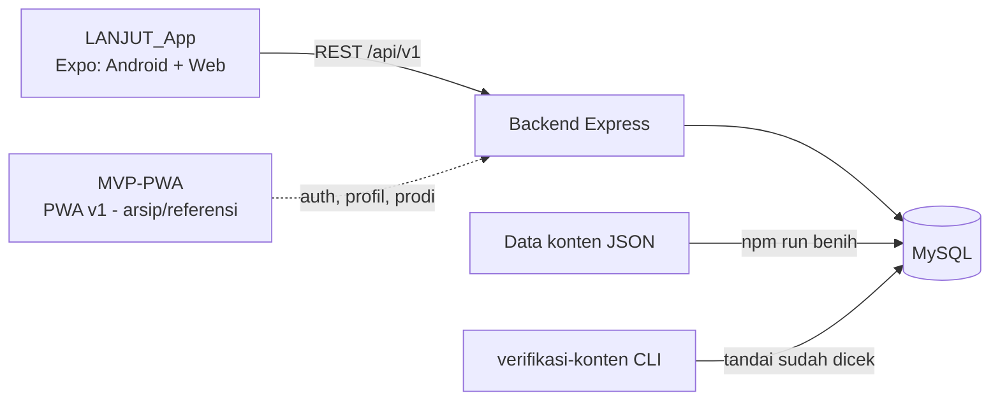

# LANJUT — Kerangka Studi Kasus Portofolio

**Status dokumen:** kerangka untuk diisi tim EDILAKSO GROUP. Isinya hanya fakta yang sudah terjadi di proyek. Yang belum diketahui ditandai **[ISI]**. Jangan menulis klaim yang belum terjadi (misalnya jumlah pengguna) sebelum benar-benar tercapai.

**Terakhir dicocokkan dengan repo:** 28 September 2026, commit `c51a980` (jumlah tes, jumlah prodi/mapel, isi data konten, dan riwayat commit di Bagian 6). Cocokkan ulang sebelum dipublikasikan.

---

## 1. Ringkasan (satu paragraf)

LANJUT adalah aplikasi yang membantu siswa SMK kelas 12 memahami jalur menuju kuliah: kapan harus melakukan apa, posisi dirinya sekarang, mapel TKA yang relevan, dan langkah yang perlu disiapkan. Dibangun oleh tim siswa RPL sebagai PWA (v1), lalu dilanjutkan sebagai aplikasi Expo (Android dan web) dengan backend Express + MySQL. **Status jujur saat ini:** prototipe berfungsi penuh dan sudah diuji otomatis; rilis ke pengguna nyata (target ≥50 siswa sebelum 23 Oktober 2026) belum terjadi **[perbarui saat tercapai]**.

## 2. Masalah dan pengguna

- Pengguna: siswa SMK kelas 12. Kebanyakan info SNBP/SNBT/TKA ditulis dengan asumsi pembacanya anak SMA, sehingga siswa SMK sering bingung soal posisinya di sistem ini.
- **[ISI]** Bukti masalah dari lapangan (hasil obrolan atau wawancara dengan siswa/guru; jangan pakai angka yang tidak pernah kalian kumpulkan).

## 3. Apa yang dibangun

| Fitur | Untuk apa |
|---|---|
| Beranda / Linimasa | Tenggat resmi dengan hitung mundur; hanya tanggal yang sudah dicek ke sumber resmi yang tampil |
| Khusus SMK | Apa yang berbeda dan apa yang bisa dilakukan siswa SMK |
| Pilih Mapel | Membantu memahami mapel TKA yang relevan per prodi (19 prodi, 10 mapel) |
| Cerita Alumni | Kartu cerita alumni (menunggu izin tertulis narasumber sebelum ada yang tayang) |
| Daftar Periksa | Checklist persiapan dengan kemajuan tersimpan di akun |
| Jalur Saya | Profil, target prodi, ringkasan kemajuan |
| Cek Posisi Gue | Menentukan tahap siswa dan langkah berikutnya, berbasis aturan (tanpa AI) |
| Akun | Daftar, masuk, keluar, dan penanganan sesi habis |

## 4. Arsitektur

- Monorepo: `MVP-PWA/`, `LANJUT_App/` (berisi `server/`), `LandingPage/`, `docs/`, `diagrams/` (UML & ERD dalam Mermaid), serta bahan desain `LANJUT UI mockups/`, `Wireframe-low fidelity/`, dan `assets/`.
- Build Android lewat EAS; backend diuji otomatis (**69 tes lolos** per 28 Sep 2026 **[perbarui angka sebelum dipublikasikan]**).
- **[ISI]** Tambahkan screenshot arsitektur atau diagram versi kalian sendiri kalau ada. Sudah ada di `diagrams/`: use case, activity (Pilih Mapel), class, dan dua ERD. Diagram itu bersumber dari `prd-sdd-lanjut.md` (era PWA), jadi cek dulu apakah masih sesuai dengan LANJUT_App sebelum dipakai.

## 5. Keputusan penting dan alasannya

| Keputusan | Alasan |
|---|---|
| PWA → Expo (satu basis kode untuk Android + web) | Satu kode untuk dua platform; PWA dijadikan MVP dan referensi |
| Login wajib di Expo (mode tamu dihapus) | Kemajuan tersimpan ke akun; trade-off: friksi di awal, risikonya diterima secara sadar (`SDD-Backend-Foundation.md` RB3). Belum ada pengukuran berapa siswa yang berhenti di layar daftar **[perbarui kalau sudah diukur]** |
| Desain online-first di Expo | App sudah wajib login, tidak ada kebutuhan offline yang dinyatakan; prinsip lama (localStorage jadi sumber kebenaran) ditandai tidak berlaku, bukan dihapus |
| Cek Posisi Gue tanpa AI | Aturan sederhana dari data yang sudah ada sudah cukup, lebih murah dan lebih bisa diprediksi |
| Tanggal hanya tampil bila sudah dicek ke sumber resmi | Lebih baik kosong tapi jujur daripada terisi tapi bisa salah; contoh: jadwal SNBP/SNBT 2027 memang belum dirilis, jadi tidak ditampilkan |
| Fitur AI (V2) hanya disiapkan spesifikasinya, belum dibangun | Ada biaya berjalan, risiko keselamatan, dan pertanyaan perlindungan data anak yang harus diputuskan dulu |

## 6. Masalah yang ditemukan dan diperbaiki (bagian terkuat untuk portofolio)

Ini menunjukkan cara berpikir, bukan sekadar hasil. Pilih 4-5 yang paling menarik untuk diceritakan lebih panjang.

| Masalah | Bagaimana ditemukan | Perbaikan | Commit |
|---|---|---|---|
| Data milik akun bocor antar-akun di HP yang sama (ditemukan dua kali, di dua tempat) | Uji dengan dua akun bergantian | Cache kemajuan dibersihkan saat ganti akun; pilihan kelas/jalur di perangkat disimpan per akun | `c976e71`, `011118c` |
| Hapus centang tidak tersimpan | Uji dua arah, bukan hanya centang | Status ditentukan dari tanggal selesai di server (hapus centang hanya mengosongkan tanggal itu) | `0341ff6` |
| Skor latihan di PWA tertulis tetap ("9 benar dari 12") | Uji di browser: jawaban salah tetap menulis angka yang sama | Diisi dari jawaban sesi; aturan baru di gerbang validasi menolak skor tertulis tetap | `e350a47` |
| Tanda "sudah dicek" terhapus tiap benih dijalankan | Ditemukan saat dua tugas berjalan paralel | Benih tidak menyentuh kolom verifikasi baris yang sudah ada | `1a26cbf` |
| Tanda "sudah dicek" bisa basi kalau tanggal diubah | Analisis desain | Isi berubah → tanda otomatis kembali ke "belum dicek" | `07ef201` |
| Batas laju di belakang proxy berlaku ke semua pengguna sekaligus (siswa ke-6 dalam satu kelas bisa ditolak mendaftar) | Audit kesiapan deploy | Pengaturan jumlah proxy lewat env | `1c19e9b` |
| Tanggal TKA di data contoh berbeda dari sumber resmi | Pencocokan dengan siaran pers Kemendikdasmen | Menolak menandai data yang salah; data diperbaiki dulu baru ditandai | `5b8bbe4` |
| Paket build 221 MB (dua APK lama ikut terkemas), upload EAS terus putus | Investigasi log, lalu diperiksa dengan `eas build:inspect` | EAS hanya membaca `.gitignore` root, jadi aturan abaikan ditambahkan di sana; arsip jadi 19 MB. Ikut ketemu folder `.expo` (berisi log dengan IP dan path laptop) yang seharusnya tidak terunggah | `19edc25`, `85a7ff0` |
| Teks sulit dibaca di Expo: penafian/sumber 2,2:1, teks putih di kartu gradasi 1,3-2,0:1, tombol utama dan keping terpilih 2,63:1, tombol sekunder 4,04:1 | Audit kontras (rumus WCAG, dihitung terhadap titik gradasi terburuk) | Semua naik lewat token warna yang sudah ada, tanpa mengubah tata letak: penafian 9,8:1; kartu gradasi 4,9-8,7:1; tombol utama dan keping 5,69:1; tombol sekunder 6,96:1. PWA belum diubah **[perbarui kalau PWA ikut diperbaiki]** | `99c46cb`, `29abf99`, `c51a980` |

## 7. Proses kerja tim

- **[ISI]** Ceritakan pembagian peran dan cara kalian menyatukan banyak "isi kepala" (ini tujuan awal EDILAKSO GROUP).
- Alur kerja yang dipakai: pekerjaan dipecah jadi tugas bernomor dengan batasan jelas dan kriteria selesai; tiap tugas diakhiri laporan; keputusan dan temuan dicatat.
- Pembuatan kode dibantu AI (Claude Code). **Tuliskan dengan jujur** bagian mana yang dikerjakan dengan bantuan AI dan bagian mana keputusan tim; penilai portofolio biasanya menghargai kejelasan ini.

## 8. Hasil yang boleh diklaim (dan yang belum)

**Boleh, asal angkanya diperbarui saat dipublikasikan:**
- Fitur di Bagian 3 berfungsi dan sudah diuji di browser
- Backend punya tes otomatis (angka terakhir: 69 lolos)
- Data TKA 2026 dicocokkan ke sumber resmi

**Jangan diklaim sebelum terjadi:**
- Jumlah pengguna, retensi, atau dampak ke siswa
- "Aman" atau "terenkripsi" untuk data siswa
- Fitur AI (belum dibangun)

## 9. Yang belum selesai dan pelajaran

- Hosting backend publik belum berjalan **[perbarui]**. Setelah hosting jalan, APK preview perlu dibangun ulang dengan alamat backend publik.
- Cerita alumni menunggu izin tertulis (data sekarang hanya 2 cerita contoh, keduanya belum diizinkan tayang)
- Jadwal SNBP/SNBT 2027 menunggu rilis resmi (per 28 Sep 2026 yang bersumber resmi baru 3 tahapan TKA)
- Pelajaran yang bisa diceritakan: data yang ditampilkan ke remaja harus punya sumber; desain yang "kelihatan jalan" bisa menyembunyikan bug data; dokumentasi keputusan lama perlu ditandai usang, bukan dibiarkan.

## 10. Yang perlu diisi tim sebelum dipublikasikan

- [ ] Nama anggota dan peran masing-masing (kontribusi asli, bukan pembagian rata). Catatan: semua 75 commit di repo saat ini tercatat atas nama satu akun git, jadi log kontribusi per anggota (Bagian 11 no. 4) tidak bisa diambil otomatis dari git dan perlu disusun manual
- [ ] 4-6 screenshot terbaik (Beranda, Cek Posisi, Pilih Mapel, Daftar Periksa, Jalur Saya)
- [ ] Link repo dan (kalau sudah ada) link demo atau APK
- [ ] Bukti masalah dari lapangan (Bagian 2)
- [ ] Angka yang diperbarui (tes lolos, tanggal, status hosting)
- [ ] Periksa: tidak ada kredensial, IP pribadi, atau data pengguna di screenshot dan repo publik

## 11. Format yang disarankan

1. `README.md` repo: ringkasan, fitur, cara menjalankan, tautan ke studi kasus ini
2. Satu halaman studi kasus (dokumen ini, setelah diisi)
3. 4-6 screenshot + diagram arsitektur
4. Log kontribusi per anggota (siapa mengerjakan apa, dengan tautan commit)
